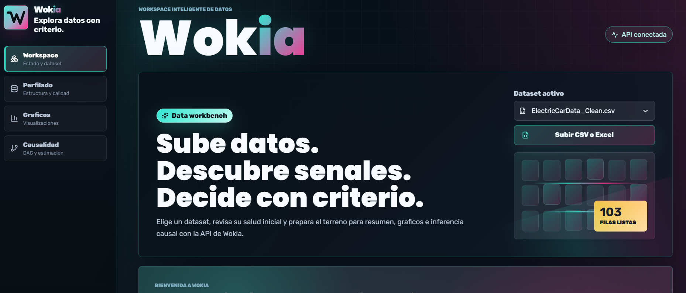

# Wokia

**Tu espacio para explorar datos con criterio.**

Wokia nació como mi Trabajo de Fin de Grado. La idea era crear una especie de pequeño asistente de ciencia de datos que me ayudara a dar los primeros pasos con un dataset desconocido: entender qué contiene, detectar posibles problemas y empezar a hacer preguntas.

Después del TFG seguí trabajando en el proyecto y añadí una interfaz con React y una API con FastAPI. Esta es la versión actual.

## Wokia en acción

[](https://github.com/user-attachments/assets/b3962a7c-1403-4aeb-af66-5e688cfbdc14)

## ¿Qué se puede hacer?

- **Conocer los datos:** cargar un CSV o Excel y revisar una muestra de sus primeras filas.
- **Explorar el dataset:** pedir al asistente que analice su estructura, columnas, valores nulos, duplicados, correlaciones y posibles valores extremos. También puede proponer nuevas variables y una variable objetivo.
- **Crear gráficos:** describir lo que quieres visualizar con una frase y descargar el resultado en PNG.
- **Plantear un análisis causal:** partir de una pregunta o elegir un tratamiento manualmente, revisar y editar el DAG, y continuar con la identificación, estimación y comprobación de robustez.

El asistente utiliza un modelo de lenguaje mediante la API de Groq o Gemini. Algunas tareas del flujo causal también utilizan DoWhy.

## Cómo probar Wokia

Estas instrucciones están pensadas para Windows con PowerShell.

### 1. Preparar el proyecto

Necesitarás Python 3.12, Node.js, npm y una clave de API de Groq o Gemini.

Abre una terminal en la carpeta del proyecto, crea un entorno virtual e instala las dependencias:

```powershell
python -m venv venv
.\venv\Scripts\Activate.ps1
python -m pip install -r requirements.txt
```

### 2. Configurar el modelo

Para usar Groq, crea el archivo de configuración a partir de la plantilla:

```powershell
Copy-Item envs\groq.env.example envs\groq.env
```

Abre `envs/groq.env` y sustituye el valor de `GROQ_API_KEY` por tu clave. El modelo configurado en la plantilla es `openai/gpt-oss-120b`, al que se accede mediante Groq.

Los modelos disponibles y sus límites pueden cambiar, así que conviene revisar la configuración de tu cuenta si una petición falla. No subas tu clave al repositorio: los archivos `envs/*.env` están incluidos en `.gitignore`.

### 3. Arrancar la aplicación

Con el entorno virtual activado, inicia la API desde la raíz del proyecto:

```powershell
uvicorn backend.main:app --reload --port 8000
```

Abre otra terminal en la misma carpeta e inicia la interfaz:

```powershell
cd frontend
npm install
npm run dev
```

Abre [http://127.0.0.1:5173](http://127.0.0.1:5173) en el navegador y sube un CSV o Excel para empezar. Mantén las dos terminales abiertas mientras uses Wokia.

Los archivos que subas se guardan localmente en `auto_doc/files/` y no se incluyen en el repositorio.

## Tecnologías

- React y TypeScript para la interfaz.
- FastAPI y Python para el backend.
- LangChain y modelos accesibles por API para las tareas del asistente.
- Pandas, Matplotlib, Seaborn y DoWhy para el análisis, las visualizaciones y la inferencia causal.

La documentación de la API está disponible en [http://localhost:8000/docs](http://localhost:8000/docs) mientras el backend está en marcha. En `docs/api_examples/` hay ejemplos para probar los endpoints.

## Antes de sacar conclusiones

Wokia es un proyecto exploratorio: las respuestas del modelo pueden contener errores y conviene revisarlas. En particular, los resultados causales dependen de los datos, el DAG y los supuestos elegidos. Una correlación o una prueba de robustez no demuestran por sí solas que exista causalidad.

Algunas funciones ejecutan código Python generado por el modelo. Usa la aplicación en un entorno local de confianza, revisa el código generado y evita exponer la API a Internet. Antes de cargar datos sensibles, ten en cuenta que algunas tareas envían información al proveedor del modelo.
